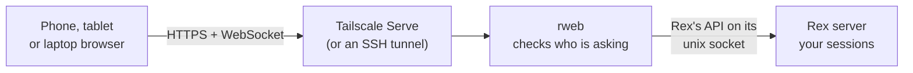

# rweb

**A web client for [Rex](https://www.superlogical.com/rex), the terminal multiplexer, for when you are
away from your Rex machines.** Open your Rex sessions in a phone, tablet or laptop browser, answer the
prompt that is waiting, run the quick command, and go. Not affiliated with Superlogical.

Version 0.1.0. What changed in each version: [CHANGELOG.md](CHANGELOG.md).

## Why

Long-running work lives in Rex sessions: builds, servers, coding agents that stop to ask a question.
When you are away from the machine, the thing you need is small: approve a step, type an answer, check
an output, restart something. rweb makes that possible from the device in your pocket, without
installing an app, without opening Rex's API to the network and without a third-party relay.

It is built for quick responses, not for full-time terminal work: the page is designed for a phone
first (a key bar for the keys a phone keyboard lacks, touch scrolling, fit-to-screen), and when you are
back at a real keyboard you use Rex itself.

## What it does

- Lists your Rex sessions and terminals; opens one full screen; creates, renames and closes them.
- Shows the terminal as Rex has it (colours, wide characters, full-screen programs), with recent history,
  live while you type; reconnects by itself after sleep or a network change.
- Shows what each terminal is doing at a glance: the running program, its folder, listening ports and,
  where a program reports it, its status.
- Phone and tablet friendly: key bar (Enter, Esc, Tab, ^C, Ctrl, Alt, Shift, arrows and more), touch
  scrolling (also inside full-screen programs), a Copy view, a view-only switch.
- Optional file transfer: download a file from the machine, upload into one folder (off by default).
- Runs only for you. One rweb per machine: each machine with Rex runs its own rweb, at its own address.

## How it works



rweb is one program that runs as you, next to Rex, and talks to Rex only over Rex's own unix socket. It
mirrors the output of each terminal someone is viewing into a [libghostty-vt](https://ghostty.org)
terminal, so every browser that joins gets an exact redraw, then the live output. The page is built into
the program. More: [docs/architecture.md](docs/architecture.md).

It never listens on the network itself. You reach it in one of two ways:

- **Tailscale (recommended):** Tailscale Serve publishes rweb on your tailnet with HTTPS and tells it who
  is asking; rweb accepts only your own Tailscale login. Works from a phone with the Tailscale app.
- **SSH tunnel:** rweb listens on loopback with a token; you forward a port with `ssh -L` and open it
  locally. No Tailscale needed; your phone or laptop needs an SSH client that forwards ports.

## Quick start (Tailscale)

You need Rex running, [Tailscale](https://tailscale.com/download) on the Rex machine and on your phone
(same account, with MagicDNS and HTTPS certificates turned on for the tailnet), and a release archive.

```sh
shasum -a 256 -c SHA256SUMS --ignore-missing     # Linux: sha256sum -c SHA256SUMS --ignore-missing
tar -xzf rweb-0.1.0-<platform>.tar.gz
mkdir -p ~/.local/bin && install -m 0755 rweb-0.1.0-<platform>/rweb ~/.local/bin/rweb
```

Linux (a unix socket that only Tailscale can reach):

```sh
mkdir -p -m 0700 "$XDG_RUNTIME_DIR/rweb"
rweb --listen-unix "$XDG_RUNTIME_DIR/rweb/bridge.sock" --owner-from-tailscale &
sudo tailscale serve --bg --https=12443 "unix:$XDG_RUNTIME_DIR/rweb/bridge.sock"
```

macOS (loopback plus a secret path that only Tailscale Serve knows):

```sh
mkdir -p ~/.config/rweb && (umask 077; head -c 32 /dev/urandom | base64 | tr '+/' '-_' | tr -d '=\n' > ~/.config/rweb/backend-secret)
rweb --listen-tcp 7695 --owner-from-tailscale --backend-secret-file ~/.config/rweb/backend-secret &
tailscale serve --bg --https=12443 "http://127.0.0.1:7695/$(cat ~/.config/rweb/backend-secret)"
```

Open `https://<machine>.<tailnet>.ts.net:12443/` on your phone. The **[user guide](docs/user-guide.md)**
covers Tailscale setup step by step, the SSH tunnel, starting rweb at boot or login, several machines,
using the page, upgrading and troubleshooting.

## Security, in short

rweb can do anything you can do in Rex, so it trusts no one but you. It listens only on a unix socket
or on loopback, never on the network. Behind Tailscale it accepts only your Tailscale login and refuses
requests from the public internet (Funnel), from the machine itself, for another host name, or a
WebSocket opened by another site. Behind an SSH tunnel it requires a long token. It never starts or asks
for an open Rex listener, and file transfer is off unless you turn it on. Design and review:
[docs/security-hardening-2026-11-23.md](docs/security-hardening-2026-11-23.md) (in the source repository).

## Building from source

[Zig](https://ziglang.org) 0.17.1:

```sh
zig build -Doptimize=ReleaseSafe     # zig-out/bin/rweb
zig build test                        # unit tests; REX_SOCKET=<socket> adds live tests (they make and close their own sessions)
zig build web-test                    # the page's logic (needs Node)
zig build dist                        # release archives for macOS arm64 and Linux x86-64 in zig-out/dist
tools/release.sh [COMMIT]             # the same, reproducibly, from a clean export of one commit
```

## Documentation

| | |
| --- | --- |
| [User guide](docs/user-guide.md) | Tailscale or SSH setup, run at boot, several machines, using the page, upgrade, troubleshooting |
| [Architecture](docs/architecture.md) | Components, diagrams, data and input paths, access checks, source layout |
| [Changelog](CHANGELOG.md) | What changed in each version |
| [Licence](LICENSE) | MIT |
| [Third-party notices](THIRD-PARTY-NOTICES.md) | Software rweb contains or serves, with licences |
| [All documents](docs/README.md) | Plan, design research, security review and test records (in the source repository) |

## Licence

rweb is released under the [MIT licence](LICENSE), the same licence as Ghostty and libghostty-vt, on
which it is built. The software it contains or serves keeps its own licences:
[THIRD-PARTY-NOTICES.md](THIRD-PARTY-NOTICES.md).

## Status

0.1.0 is in daily use on Linux and macOS. Rex is a preview: rweb pins the Rex API revisions it speaks
(see `rweb --version`) and is tested against each Rex update. Release archives: macOS on Apple silicon,
and Linux x86-64 (static, any distribution). Windows support will come later.
