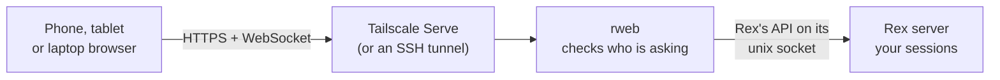

<h1>
  <picture>
    <source media="(prefers-color-scheme: dark)" srcset="assets/logo/lockup.svg">
    <source media="(prefers-color-scheme: light)" srcset="assets/logo/lockup-light.svg">
    
  </picture>
</h1>

**A web client for [Rex](https://www.superlogical.com/rex), the terminal multiplexer, for when you are
away from your Rex machines.** Open your Rex sessions in a phone, tablet or laptop browser, answer the
prompt that is waiting, run the quick command, and go. Not affiliated with Superlogical.

What changed in each version, and the current one: [CHANGELOG.md](CHANGELOG.md). `rweb --version` names
the version you have.

## Why

Long-running work lives in Rex sessions: builds, servers, coding agents that stop to ask a question.
When you are away from the machine, the thing you need is small: approve a step, type an answer, check
an output, restart something. rweb makes that possible from the device in your pocket, without
installing an app, without opening Rex's API to the network and without a third-party relay.

It is built for quick responses, not for full-time terminal work: the page is designed for a phone
first (a key bar for the keys a phone keyboard lacks, touch scrolling, fit-to-screen), and when you are
back at a real keyboard you use Rex itself.

## What it does

- Lists your Rex sessions and terminals; opens one full screen; creates, renames and closes them.
- Shows the terminal as Rex has it (colours, wide characters, full-screen programs), with recent history,
  live while you type; reconnects by itself after sleep or a network change.
- Shows what each terminal is doing at a glance: the running program, its folder, listening ports and,
  where a program reports it, its status.
- Phone and tablet friendly: key bar (Enter, Esc, Tab, ^C, Ctrl, Alt, Shift, arrows and more), touch
  scrolling (also inside full-screen programs), a Copy view, a view-only switch.
- Optional file transfer: download a file from the machine, upload into one folder (off by default).
- Runs only for you: your own Tailscale login (every device you signed in to Tailscale as you), or a
  token. One rweb per machine: each machine with Rex runs its own rweb, at its own address.

## How it works



rweb is one program that runs as you, next to Rex, and talks to Rex only over Rex's own unix socket. It
mirrors the output of each terminal someone is viewing into a [libghostty-vt](https://ghostty.org)
terminal, so every browser that joins gets an exact redraw, then the live output. The page is built into
the program. More: [docs/architecture.md](docs/architecture.md).

It never listens on the network itself. You reach it in one of two ways:

- **Tailscale (recommended):** Tailscale Serve publishes rweb on your tailnet with HTTPS and tells it who
  is asking; rweb accepts only your own Tailscale login. Works from a phone with the Tailscale app.
- **SSH tunnel:** rweb listens on a unix socket that only your own user can connect to; you forward a
  port to it with `ssh -L`, open it locally and sign in with a token. No Tailscale needed; your phone or
  laptop needs an SSH client that forwards a port to a unix socket.

## Quick start (Tailscale)

You need Rex running, [Tailscale](https://tailscale.com/download) on the Rex machine and on your phone
(same account, with MagicDNS and HTTPS certificates turned on for the tailnet), and a release archive.

```sh
shasum -a 256 -c SHA256SUMS --ignore-missing     # Linux: sha256sum -c SHA256SUMS --ignore-missing
tar -xzf rweb-<version>-<platform>.tar.gz
mkdir -p ~/.local/bin && install -m 0755 rweb-<version>-<platform>/rweb ~/.local/bin/rweb
```

The checksums catch a damaged download, not a changed release: they come from the same place as the
archives.

Then, on the Rex machine:

```sh
rweb tailscale
```

rweb sets up the rest itself and prints the one command that is left, a `tailscale serve` line (with
`sudo` on Linux), and the address to open. Run that line once in another terminal, then open
`https://<machine>.<tailnet>.ts.net:12443/` on your phone.

- **Linux:** rweb listens on a unix socket in a folder of yours that only Tailscale can connect to.
- **macOS:** the Tailscale app cannot forward to a unix socket, so rweb listens on loopback behind a
  secret path that only Tailscale Serve knows (rweb makes the secret). Only on a Mac where you are the
  only local account: the secret is part of the Serve target, so other accounts may be able to read it in
  `tailscale serve status`, or in the process list while `tailscale serve` runs.

Without Tailscale, `rweb ssh` does the same for an SSH tunnel: it makes a token and prints the `ssh` line
to run on your laptop.

Running rweb in a terminal is for a first try: when you stop it, also run
`tailscale serve --https=12443 off`, or Serve keeps sending your requests to a socket or port nobody
serves. The **[user guide](docs/user-guide.md)** covers Tailscale setup step by step, the SSH tunnel,
starting rweb at boot or login, several machines, using the page, upgrading and troubleshooting.

## Security, in short

rweb can do anything you can do in Rex, so it trusts no one but you. It listens only on a unix socket
or on loopback, never on the network. Behind Tailscale it accepts only your Tailscale login and refuses
requests from the public internet (Funnel), from the machine itself, for another host name, or a
WebSocket opened by another site; "your login" covers every device you sign in to Tailscale as you, so keep
it on devices only you use. Behind an SSH tunnel it requires a long token and listens on a unix socket in
a private folder, so no other account can take its place while it is down; the tunnel's local end is plain
HTTP on loopback, which cannot prove who is answering, so use it only on devices nobody else uses. It never
starts or asks
for an open Rex listener, and file transfer is off unless you turn it on. It reads its secrets only from
files that are yours and closed to others, on a local disk, in folders no other user or group can
change, and it bounds what every browser and Rex can make it hold in memory. Design:
[docs/security-hardening-2026-11-23.md](docs/security-hardening-2026-11-23.md) (in the source repository).

**How it was reviewed.** Before its first release, rweb went through a security review of its design
and then five rounds of review on its release candidate. Each round had three independent parts: an
external static security scan of the whole repository; a release-readiness review (builds, the test
suite, the release archives, the docs against the code); and an internal adversarial review in several
parts, each reviewer reading the code without the others' conclusions. In the first four rounds the
internal review was split by area (request handling and authentication, the Rex client, concurrency, the
page and tooling); the fifth followed each earlier finding across every endpoint, platform and documented
procedure, and led to the two setup commands, `rweb tailscale` and `rweb ssh`. Every finding was checked
against the code before anything was changed, and each fix has a test. Over the first four rounds that
came to more than 120 findings, among them a deadlock, use-after-free races, a paste that could escape
bracketed paste, memory a program in a terminal could grow without bound, and trust in file paths that
another local user could subvert. All are fixed, or documented as limits with the reason. Before each
release the candidate is run live on macOS and Linux and tested from the Android and iOS simulators and
a phone; those runs are recorded in the round's document. Each round's record lists its findings and
their verdicts, fixes and tests: [round 1](docs/release-review-2026-11-25.md),
[round 2](docs/security-review-2026-11-25-round2.md), [round 3](docs/security-review-2026-11-25-round3.md),
[round 4 and its live test](docs/security-review-2026-11-25-round4.md),
[round 5](docs/security-review-2026-11-26-round5.md) (in the source repository).

## Building from source

[Zig](https://ziglang.org) 0.17.1:

```sh
zig build -Doptimize=ReleaseSafe     # zig-out/bin/rweb
zig build test                        # unit tests; REX_SOCKET=<socket> adds live tests (they make and close their own sessions)
zig build web-test                    # the page's logic (needs Node)
zig build dist                        # archives of this working tree (uncommitted edits included) in zig-out/dist
tools/release.sh [COMMIT]             # release archives: one commit's clean export, tested, built with the pinned Zig
```

## Documentation

| | |
| --- | --- |
| [User guide](docs/user-guide.md) | Tailscale or SSH setup, run at boot, several machines, using the page, upgrade, troubleshooting |
| [Architecture](docs/architecture.md) | Components, diagrams, data and input paths, access checks, source layout |
| [Changelog](CHANGELOG.md) | What changed in each version |
| [Licence](LICENSE) | MIT |
| [Third-party notices](THIRD-PARTY-NOTICES.md) | Software rweb contains or serves, with licences |
| [All documents](docs/README.md) | Plan, design research, security review and test records (in the source repository) |

## About this project

I built rweb for my own workflow. I work across several machines joined by Tailscale and moved my
terminal work to Rex: my previous setup served me well, but Rex offers more to look forward to, Windows
support among it. The one thing missing was an occasional look at my terminal sessions from a phone or a
tablet.

Rather than build something large, I settled on the smallest thing that does the job: a web proxy that
is as plain as possible, one per machine, each reached over Tailscale. It reuses what the Rex ecosystem
already provides and follows its practices: libghostty for the terminal on the machine and its
WebAssembly build in the browser, Rex's own protocols, and Zig, the language Ghostty, libghostty and Rex
use.

It was made for my purposes, but I have kept it as general as I could so that others can use it too. I
use it myself and will keep publishing point releases as I find things worth adding or fixing. If
Superlogical, or anyone else, comes up with something better, I may pause or stop work on rweb at that
point. It is released under the MIT licence, like libghostty.

I built it with AI coding assistants rather than writing each line by hand: Anthropic's Claude,
OpenAI's Codex and Google's Antigravity wrote, tested and reviewed the code and helped prepare the
releases, under my direction. The design decisions and the responsibility for the result are mine, and
"How it was reviewed" above describes the checks it went through.

rweb is a one-person project, so please do not expect me to take pull requests. You are free to fork it
and improve it. When I see changes elsewhere that would help, I will try to merge them, rework them or
bring them in some other way.

Thank you to Superlogical for Rex.

## Licence

rweb is released under the [MIT licence](LICENSE), the same licence as Ghostty and libghostty-vt, on
which it is built. The software it contains or serves keeps its own licences:
[THIRD-PARTY-NOTICES.md](THIRD-PARTY-NOTICES.md).

## Status

rweb is in daily use on Linux and macOS. Rex is a preview: rweb pins the Rex API revisions it speaks
(see `rweb --version`) and is tested against each Rex update. Release archives: macOS on Apple silicon,
and Linux x86-64 (static, any distribution). Windows support will come later.
