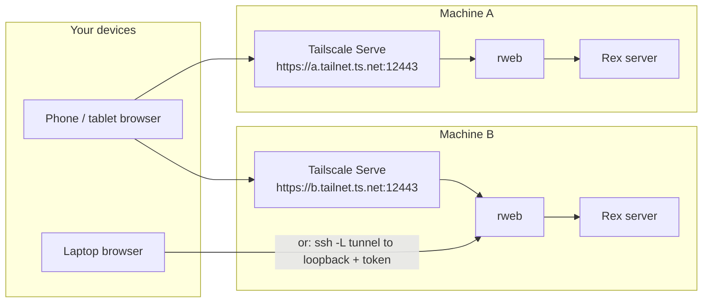
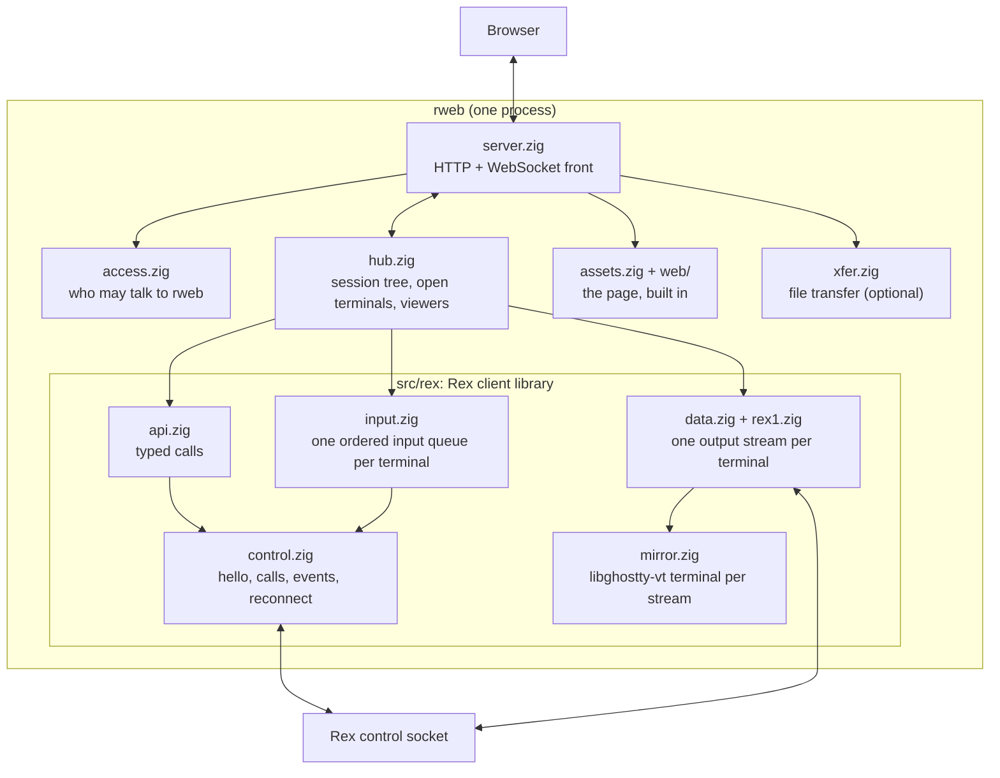
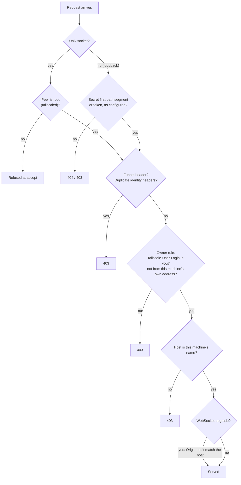
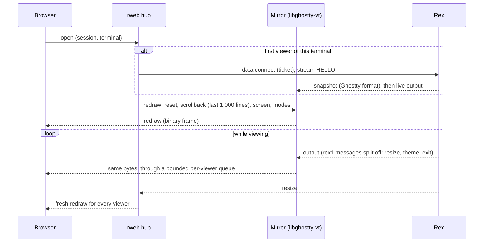
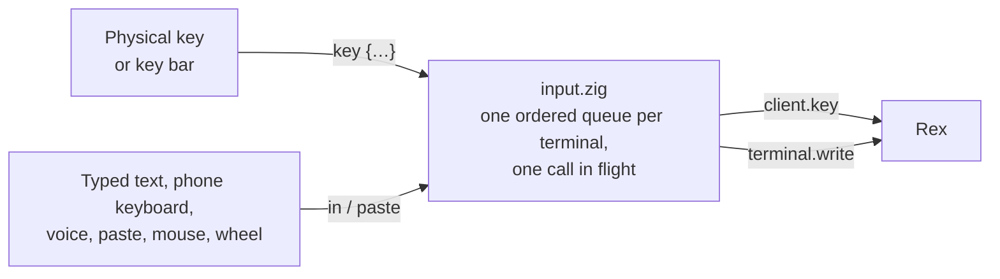

# rweb architecture

How rweb is put together: where it runs, how a request is checked, how terminal output reaches the
browser and how input gets back to Rex. For setup see the [user guide](user-guide.md); for the reasons
behind each choice, the plan and the test records linked at the end (in the source repository).

## Where it runs

One rweb per machine that runs Rex. Each rweb serves only its own Rex, runs as the same user as Rex, and
talks to Rex only through Rex's own unix socket. It never listens on the network: Tailscale Serve or an
SSH tunnel brings the browser to it.

## Inside rweb

- The **Rex client library** (`src/rex`) knows Rex's protocols and nothing about browsers. The **browser
  protocol** (`protocol.zig`) is rweb's own, so a change in Rex stays inside the library.
- rweb holds **one control connection** to Rex for calls and events, and **one data connection per
  terminal that at least one browser is viewing** (Rex allows one per client per terminal).
- The page (HTML, JavaScript, the browser terminals wterm and xterm.js) is **embedded in the binary**;
  nothing is loaded from elsewhere, and the vendored files are pinned by checksum.
- The library treats what Rex sends, and what programs print, as untrusted. It sets its own ceilings
  (at most 16 MiB per message whatever Rex advertises; a reconnect token of at most 256 printable
  bytes; JSON nested at most 64 deep), gives every handshake 10 seconds, and keeps Rex's events in a
  fixed ring (1,024 events, 4 MiB): on overflow the queued events collapse into one "dropped" notice,
  which makes the hub re-read the tree, and connection notices are never lost. Rex's own messages inside
  a terminal's output (`rex1`) are split off by a small state machine that keeps every other byte in
  order; a resize must be 1 to 4,096 cells on each side and at most 1,048,576 cells, or it is ignored.
  A mirror that fails (a bad snapshot, out of memory) reports it as the stream's end, and the hub opens
  a new stream, as it does when Rex asks for one.

## A request, from the browser to rweb

Every check is a pure function in `access.zig`, so each refusal has a test that shows it refusing. On
Linux the unix socket is in a `0700` directory and accepts only root; on macOS the loopback listener
answers anything without the secret with a bare 404. With an SSH tunnel the token rule replaces the
owner rule: the token arrives once in the address (`/?token=`), and rweb answers with a redirect to
`/s/<id>/`, where `<id>` is a hash of the token. It does not show the token, but anyone who sees it can
check guesses of the token against it, so tokens are random (the user guide's generator; `--token` must
be 16 or more URL-safe characters) and the address is kept as private as the token. The token moves into an
`HttpOnly`, `SameSite=Strict` cookie scoped to that path, and leaves the address bar. A browser sends a
cookie to every port of a host, so a cookie for `/` on `127.0.0.1` would also reach any other local web
service you open, and two tunnels on two ports would overwrite each other's; scoped to its own path it
reaches neither. The page uses relative addresses only, so it works under `/s/<id>/` and, behind Serve,
at `/`.

Before a request is read, it holds one of a few pending slots. When they are all taken, the oldest
connection that has not sent a request yet is dropped for the new one: idle connections from a local
process cannot keep the owner out, while Serve, which sends its request at once, gets through.

A request whose target holds a control byte or a space is refused before anything else looks at it, and
every redirect is built only from what rweb knows plus a percent-encoded query, after the access check.
The responses that set the token cookie are never cached (`no-store`); the page's own files and the
vendored scripts are revalidated on every load (`no-cache` with an ETag), so an upgrade reaches the
browser at once. `/api/tree` and the lab pages exist only with `--enable-lab`.

Secret files (the backend secret, the token file) and the upload folder are trusted only through an
open descriptor: every folder from `/` down is opened without following links and must be root's or
yours and not writable by others (unless sticky, as `/tmp` is); the file itself must be a regular file of
yours closed to others, and is read from the descriptor that was checked. The upload folder stays open for
the life of the process and files are created relative to it, so replacing its path later changes
nothing. The unix socket's folder must be yours and `0700`.

A browser connection that goes quiet for 20 seconds, or whose socket does not take a frame within 30
seconds, is dropped, so a phone that stopped reading cannot hold a slot, a viewer or a stream. A page
may send at most 200 messages in any one second, and at most 8 heavy requests (reads, transfers,
redraws, opening or sizing a terminal, terminal actions, management) a second.

## Opening a terminal

- The mirror decodes Rex's snapshot into a libghostty-vt terminal and keeps feeding it the live output,
  so any browser can join at any time and get an exact redraw. Reconnecting is the same: a fresh redraw,
  no byte-exact resume.
- A redraw is a terminal reset followed by libghostty-vt's formatter output with every extra (colours,
  modes, cursor); while a full-screen program is up, the main screen is drawn first.
- Each viewer has a bounded send queue. A viewer that falls behind loses its queued output and gets a
  fresh redraw, so a slow phone never holds up the others or the read from Rex. The bound covers every
  frame: live output (1 MiB, then a redraw), at most one redraw (its scrollback capped at 10,000 rows,
  chosen before anything is formatted), replies (256 frames, 8 MiB, then dropped), and state frames
  (mode, Rex up or down, theme, tree), which replace their own queued copy. `closed` and `exited` always
  get through. The Copy view's text is built from at most the last 20,000 rows and 1 MiB.
- A terminal lives while anything refers to it: each viewer looking at it, and each task using it for a
  moment (a typed key, a redraw, the Copy view, a stream restart). Closing it (its block went away) takes
  it out of the list and detaches its viewers at once; the last reference destroys it. The hub's main
  lock is never held while waiting on Rex: attaching, opening a stream, waiting for its snapshot and
  restarting a stream all happen outside it, so one slow terminal cannot stall the others.
- The mirror never answers terminal queries: Rex's own terminal already answered the program, and the
  page drops any reply the browser terminal produces.

## Input, from the browser to Rex

Keys go to Rex's `client.key`, so Rex encodes them for whatever keyboard mode the program uses. Text,
pastes and mouse reports go to `terminal.write`. Rex runs writes concurrently, so rweb keeps one call in
flight per terminal and queues the rest in order. On a phone a drag over a full-screen program becomes
mouse-wheel reports (or ↑/↓ keys if the program did not ask for the mouse).

## The browser protocol

WebSocket at `/ws`. JSON text frames carry commands and notices; binary frames carry terminal output.
Browser to rweb: `tree`, `open`, `close_view`, `in`, `key`, `paste`, `fit`, `redraw`, `more_history`,
`text`, `info`, `clip`, `observe`, `new_session`, `new_terminal`, `rename_session`, `rename_block`,
`close_block`, `destroy_session`, `term_action`, transfer requests, `ping`. rweb to browser: `tree`,
`opened`, `size`, `theme`, `exited`, `closed`, `mode`, `info`, `notice`, `error`, `pong`. Every message
is bounded and validated; the full list is at the top of `src/bridge/protocol.zig`.

## Source layout

| Path | What it is |
| --- | --- |
| `src/rex/` | Rex client library: `ws.zig` (WebSocket over a unix socket), `control.zig` (hello, revisions, calls, events, reconnect), `api.zig` (typed calls), `data.zig` and `rex1.zig` (output streams), `mirror.zig` (libghostty-vt terminal), `input.zig` (ordered input), `transfer.zig` (downloads), `wire.zig` (handshake parsers), `fake.zig` (a fake Rex for tests) |
| `src/bridge/` | The program: `main.zig` (start-up, `--version`), `cli.zig` (options), `access.zig` (who may talk to it), `server.zig` (HTTP and WebSocket), `protocol.zig` (browser protocol), `hub.zig` (sessions, terminals, viewers), `xfer.zig` (file transfer), `assets.zig` (embedded page) |
| `src/bridge/web/` | The page: `index.html`, `app.js`, `app.css`, `keys.js` (pure key and touch logic, tested with Node), `wterm-shim.js`, `diag.js`; `vendor/` holds xterm.js and wterm with their licences and checksums |
| `src/fuzz.zig` | Fuzz targets for every parser that reads outside bytes (`zig build fuzz --fuzz`) |
| `tests/web/` | Tests for the page's logic (`zig build web-test`) |
| `tools/` | `dist.sh` and `release.sh` (release archives; `release-base.test.sh` checks its folder rules), `notices.py` (third-party notices) |
| `spike/` | The Phase 0 proof of concept, kept for reference |

## Pinned dependencies

| | Pin | Why it matters |
| --- | --- | --- |
| Zig | 0.17.1 | Builds everything, including Ghostty's C++ |
| libghostty-vt | Ghostty tag `vt-1.0.1` (by hash in `build.zig.zon`) | Decodes Rex's snapshot format; rweb refuses an unknown snapshot version |
| Rex API | revisions 18–19 | Rex refuses clients outside its supported range |
| wterm, xterm.js | 0.6.0, 6.0.0 (checksums in `vendor/SHA256SUMS`, checked by a test) | The browser terminals |

## Further reading (in the source repository)

- [PLAN.md](PLAN.md): goal, decisions, constraints, phases.
- [phase0-result.md](phase0-result.md): the proof that a browser can show a live Rex terminal correctly.
- [design-research.md](design-research.md), [rex-web-research.md](rex-web-research.md): the evidence behind the design.
- [security-hardening-2026-11-23.md](security-hardening-2026-11-23.md): the security review and fixes.
- [file-transfer.md](file-transfer.md): file transfer design and limits.
